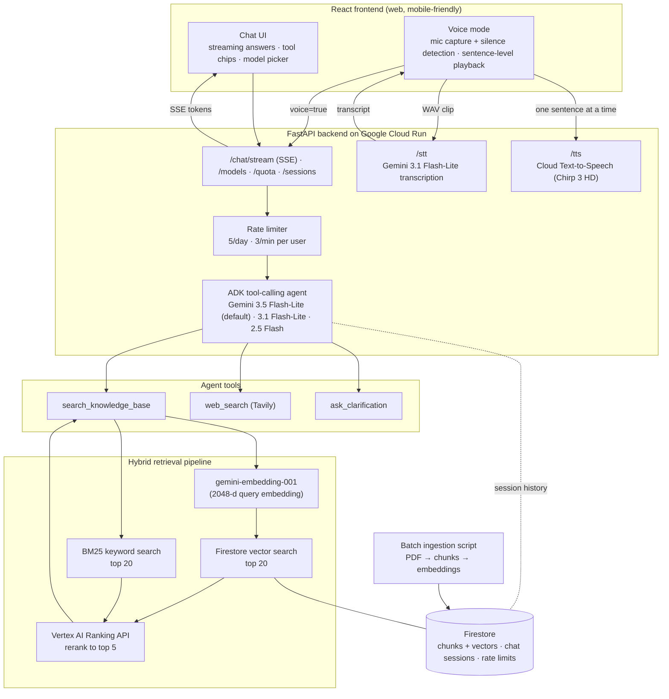
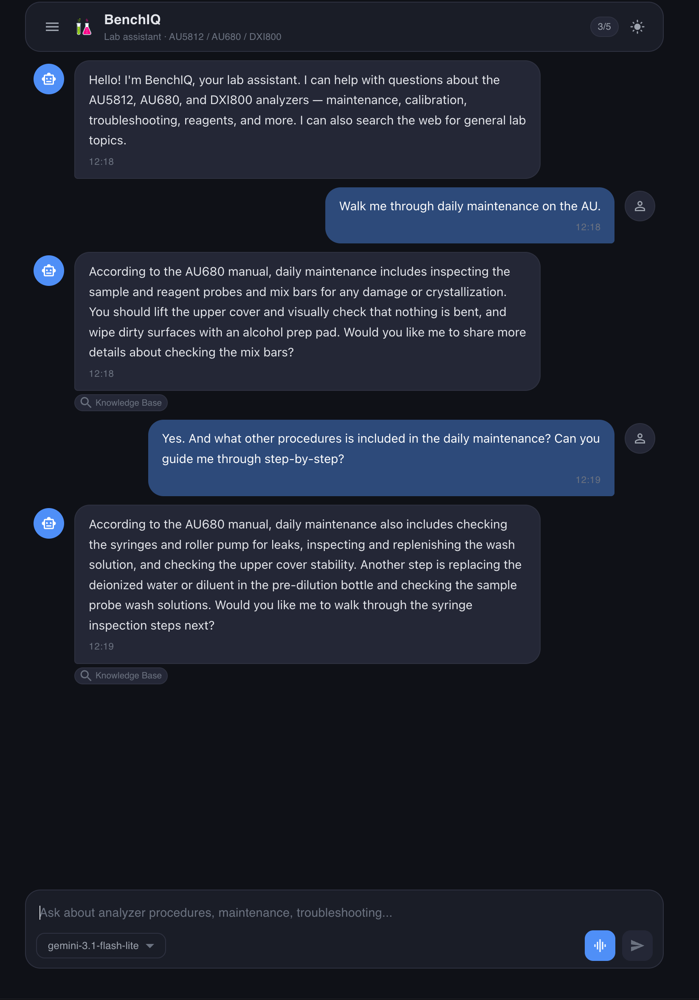

# WK 10 Project Progress Report - BenchIQ
### George Lin
### 11-11-2026

## Table of Contents

1. [Project Overview](#1-project-overview)
2. [Technical Architecture](#2-technical-architecture)
3. [Implementation Progress](#3-implementation-progress)
4. [Preliminary Results](#4-preliminary-results)
5. [Challenges](#5-challenges)
6. [Updated Milestones](#6-updated-milestones)
7. [Supporting Evidence](#7-supporting-evidence)
8. [Important Requirements](#8-important-requirements)

## 1. Project Overview

- **Project Title:** BenchIQ
- **Approved Objective:** An agentic RAG application with multimodal input (text and voice, with figures/diagrams planned), tool calling, and an evaluation study that compares retrieval and model configurations.
- **Problem Being Solved:** Traditional document control systems in healthcare environments, medical laboratories in particular, are slow to query and limited to one UI, usually a desktop web application. To find one answer, a technologist has to step away from the bench, remember the exact keywords a manual uses, and dig through near-duplicate files or paper binders. BenchIQ is an agentic RAG system for fast lookup of key operational lab procedures. It aims to be multi-platform (web, mobile) and multimodal, so healthcare and lab professionals don't have to stop what they're doing to look up key information: they can just ask in natural language, by typing or by voice, and get a grounded answer that cites the source manual and page. The current knowledge base covers instrument manuals (IFUs) for three widely used Beckman Coulter analyzers, the AU5812, AU680 and DxI 800. The people who benefit are lab technologists and scientists, plus the supervisors and trainers who field these questions every day.

## 2. Technical Architecture

A turn works like this. The user's question goes to an ADK agent, which decides which tool to call. For analyzer questions, it searches the knowledge base through a hybrid retrieval pipeline. If the knowledge base has nothing relevant, or the question is about something outside the manuals (regulations, best practices), it falls back to web search. If the question is too vague, it asks for clarification. The answer streams back to the UI with citations, and in voice mode it is read aloud one sentence at a time as soon as each sentence is ready.

- **Models:**
  - **Generation:** Gemini 3.5 Flash-Lite (default), Gemini 3.1 Flash-Lite and Gemini 2.5 Flash. The user can switch between them from a dropdown in the chat input.
    - I chose the Gemini family because it's cheap (roughly $1–5/month at my traffic), has solid tool calling, and integrates cleanly with GCP's agent tooling (ADK, Vertex AI, Firestore) under one project and one set of credentials.
    - Gemini 2.5 Flash is being retired on Vertex AI, so I upgraded this week. I kept 2.5 Flash as a legacy baseline for comparison while it's still available.
    - The newer models run with a low "thinking" setting, which keeps multi-step tool calls reliable without paying for long reasoning traces.
  - **Embeddings:** `gemini-embedding-001` at 2048 dimensions.
  - **Reranking:** Vertex AI Ranking API (`semantic-ranker-512`).
  - **Speech:**
    - Gemini 3.1 Flash-Lite transcribes speech. It's prompted with lab vocabulary so analyzer names like "AU680" and "DXI800" come out in their canonical form.
    - Google Cloud Text-to-Speech Chirp 3 HD voices read answers back.
  - **Planned:** open-weight models (e.g. Qwen or Deepseek through Ollama) in a later phase. They would power an offline mode that runs entirely on a local machine, and they give a non-commercial baseline for the evaluation.
- **Components:**
  - **Vector database: Firestore.** I chose Firestore's native vector search over the alternatives for a few reasons:
    - It's serverless and scales to zero. There's no always-on index endpoint to pay for, unlike Vertex AI Vector Search.
    - It fits in the free tier at my scale (1,478 chunks).
    - The same database also stores chat sessions and rate-limit counters, so there's only one datastore to manage.
    - I first tried GCP's managed RAG Engine, but it needed a Spanner backend at roughly $65/month, which is way over budget for a class project.
    - The trade-off: Firestore only offers a flat (brute-force) vector index and has no built-in keyword search, so I implemented BM25 in the application layer.
  - **Agent: Google Agent Development Kit (ADK), part of GCP's agent platform.** A single `LlmAgent` with three tools (knowledge-base search, web search, clarification) and routing rules in its system instruction. Sessions are stored through a custom Firestore session service, so conversations persist across Cloud Run instances and restarts.
  - **Web search: Tavily**, the agent's fallback when the knowledge base doesn't cover a question.
  - **Backend: FastAPI** with Server-Sent Events (SSE) for token streaming. It also streams agent status events like "Searching knowledge base…" so the user can see what the agent is doing.
  - **Voice input/output:** voice mode is a hands-free loop.
    - The browser captures microphone audio with the Web Audio API and runs simple voice-activity detection: it learns the ambient noise level and ends your turn after about 1.2 seconds of silence.
    - It encodes the clip as a 16 kHz WAV file and sends it to the `/stt` endpoint for transcription.
    - The transcript goes to the agent with a voice flag that tells it to answer in 2–4 short spoken sentences with no markdown.
    - The answer is split into sentences as it streams in. Each sentence is synthesized through `/tts` and played back while the next one is being fetched.
    - When the answer finishes, it starts listening again. The user can tap to interrupt at any point.
  - **Frontend: React** (React 19 + Material UI). It has streaming markdown answers, chips showing which tool was used, a chat history sidebar, a model picker, a voice-mode overlay and a dark/light theme.
- **Data Flow:**
  - **Ingestion:** currently I ingest documents in batch to Firestore with an offline script. PDFs are parsed with pypdf, split into 1,500-character chunks with 200-character overlap, embedded with `gemini-embedding-001`, and written to Firestore with their source and page number. A BM25 index of the same chunks is cached and baked into the container image so it doesn't have to be rebuilt on cold start.
  - **Query time:**
    1. The question is embedded.
    2. Firestore returns the top 20 nearest chunks, and BM25 returns the top 20 keyword matches. Both are filtered to the analyzer named in the question.
    3. The results are merged and de-duplicated.
    4. The Vertex ranker picks the top 5.
    5. The agent writes the answer from those passages and cites document and page.
  - **Later:** I plan to let users upload and ingest their own documents through an admin UI (preview, then import, with duplicate detection and per-document delete/disable).
- **Tools and Frameworks:**

| Area | Tools |
| --- | --- |
| Agent and LLM | Google ADK 2.8, google-genai SDK, Vertex AI (Gemini, embeddings, Ranking API) |
| Retrieval | Firestore vector search, LangChain BM25Retriever / rank-bm25, LangChain text splitters, pypdf |
| Voice | Web Audio API (capture and voice-activity detection), Gemini (speech-to-text), Cloud Text-to-Speech Chirp 3 HD |
| Backend | Python 3.12, FastAPI, Uvicorn, SSE streaming |
| Frontend | React 19, Material UI 7, react-markdown, Jest / React Testing Library |
| Infrastructure | Docker (linux/amd64 builds), Artifact Registry, Cloud Run, Secret Manager (Tavily key), Cloud Logging (structured JSON request and retrieval logs) |

## 3. Implementation Progress

- **Features Developed:**
  - **Agentic RAG chat:** a tool-calling agent that routes between the knowledge base, web search and clarification, and streams answers with document and page citations.
  - **Hybrid retrieval:** dense vector search plus BM25, analyzer-aware filtering (e.g. "AU680" or "DxI 800" in a question limits results to that manual), and reranking with the Vertex AI Ranking API.
  - **Switchable models:** a model dropdown in the chat input lets me run the same question through different Gemini models. This is the basis for the model-comparison part of the evaluation.
  - **Voice mode:** a fully hands-free conversation mode in the style of production LLM chat apps, covering speech-to-text, a voice-optimized answer style, sentence-by-sentence text-to-speech, tap to interrupt, and mute. When you leave voice mode, the whole spoken conversation is in the regular chat transcript.
  - **Persistent conversations:** multi-turn memory stored in Firestore, so follow-up questions keep their context, and past sessions show up in a sidebar.
  - **Guardrails for a public demo:** per-user rate limiting to limit malicious requests and attacks(5 requests/day, 3/minute, one in-flight request per session), timeouts on retrieval, web search and generation, and graceful fallbacks when a tool fails.
  - **Observability:** structured JSON logs per request (model, tools used, latency, errors) and per retrieval stage (embedding, Firestore and rerank timings, result counts).
- **Integrations Completed:**
  - **Models:** Vertex AI Gemini (three generation models through the `global` endpoint) and `gemini-embedding-001` (regional, us-west1).
  - **Retrieval:** Firestore vector search and the Vertex AI Ranking API.
  - **Web search:** Tavily, through its Python SDK.
  - **Voice:** Gemini speech-to-text and Cloud Text-to-Speech.
  - **Deployment:** Secret Manager for API keys, and Cloud Run with a dedicated service account.
  - **Data:** three Beckman Coulter IFUs (AU5812, AU680, DxI 800) ingested, 1,478 chunks in total.
- **Current Prototype Status:**
  - **Works today:** text chat with citations, KB/web routing, multi-turn memory, model switching and voice mode all work end-to-end.
  - **Deployed:** the text-chat version is live on Cloud Run at https://benchiq-149596551725.us-west1.run.app.
  - **Being deployed:** the model upgrade and voice mode were built and tested locally this week, and deploying them to Cloud Run is the next step this week.
  - **In progress:** the evaluation harness and reference question / answer set, which is the biggest remaining piece.
  - **Pending:** multimodal figure ingestion (returning diagrams with answers), user document upload, the open-weight offline mode, an explicit grounding/abstention check, and automated backend tests and CI.

## 4. Preliminary Results

### Example Inputs and Outputs

**Example 1: knowledge-base question (text, Gemini 3.5 Flash-Lite)**

> **Input:** How do I perform daily maintenance on the AU680?
>
> **Tool used:** `search_knowledge_base`
>
> **Output (excerpt):** According to the **Beckman Coulter AU680 Instructions for Use (IFU)** (*AU680-IFU.pdf*, Pages 61, 73, 190, 207–217), daily maintenance is performed during startup/standby to ensure system safety and analytical performance. **WARNING:** Maintenance procedures can expose you to biohazards… 1. **Inspect the Syringes for Leaks**: open the right front door of the analyzer. Inspect all syringes: sample syringe, wash syringe, R1 and R2 reagent syringes, and the ISE buffer syringe (if ISE is installed)… 2. **Inspect the Wash Solution Roller Pump for Leaks**…

The answer is grounded in the right manual, cites page numbers, and keeps the safety warning from the source document. That matters in a lab setting.

**Example 2: question outside the manuals (web fallback)**

> **Input:** What does CLIA require for proficiency testing frequency?
>
> **Tool used:** `web_search`
>
> **Output (excerpt):** Under the Clinical Laboratory Improvement Amendments of 1988 (CLIA)… laboratories must participate in **at least three (3) testing events per year** at approximately equal intervals… Approved PT programs must provide a minimum of **five (5) samples per testing event**…

The agent correctly recognized that this is a regulatory question the IFUs don't cover and went straight to web search.

**Example 3: the same question in voice mode**

> **Input (spoken):** How do I perform daily maintenance on the AU680?
>
> **Output (spoken, 417 characters):** "According to the AU680 manual, daily maintenance requires wearing appropriate personal protective equipment and inspecting several key components. First, check the syringes and wash solution roller pump for leaks. Second, inspect the wash solution levels and replenish them as needed. Third, inspect, clean, and prime the sample and reagent probes and mix bars. Would you like me to continue with the remaining steps?"

The same retrieval produces a short, conversational answer with no markdown. It names the source in words and offers to continue instead of reading a 2,500-character checklist out loud.

**Example 4: DxI 800 calibration (multi-step procedure)**

> **Input:** How do I calibrate the DXI800?
>
> **Output (excerpt):** To calibrate an assay on the **UniCel DxI 800 Access Immunoassay System**… 1. Navigate to Calibration Requests: go to the **Sample Manager** screen, select **New Request [F3]**, select **Calibration [F2]**… 2. Select the appropriate assay and calibrator lot number…

### Testing Observations

So far, testing has been done manually with a small script that sends fixed questions through the streaming API and records which tools were used, latency, response length and whether markdown appears. I also tested the UI and voice mode by hand in the browser.

**Successful Implementations**
- **Routing:** analyzer questions (AU680 maintenance, DxI 800 calibration) consistently went to the knowledge base and came back with correct document and page citations. The CLIA regulatory question consistently went to web search.
- **All models:** all three Gemini models answered the AU680 question correctly from the knowledge base.
- **Voice answers:** the voice flag reliably changed the style of the answer (short, no markdown) without hurting retrieval.
- **Speech-to-text:** Gemini transcription handled domain terms well. A synthesized clip saying "A U six eighty" was transcribed back as "AU680" in about 1.4–2 seconds.
- **Text-to-speech:** each sentence came back as audio in about 1.5 seconds, so the first sentence starts playing well before the full answer would have finished.
- **Persistence:** after leaving voice mode, the spoken conversation shows up in the chat history as expected.

### Initial Evaluation

**Evaluation criteria.** These are the metrics I plan to measure, with what I have so far:

| Criterion | How it will be measured | Initial observation |
| --- | --- | --- |
| Retrieval quality | Is the correct manual page among the top 5 reranked chunks? | Correct pages were retrieved for all analyzer smoke questions |
| Routing accuracy | Did the agent pick the expected tool (KB / web / clarify / abstain)? | 3/3 KB questions routed to the KB, 1/1 regulatory question routed to web, after the tracking fix |
| Faithfulness / hallucination | Is each claim supported by the retrieved passages? (LLM-as-judge plus manual spot checks) | No unsupported claims spotted in the examples, but this is not yet measured systematically |
| Citation accuracy | Does the cited document and page actually contain the information? | Citations pointed to the right manual. Page-level accuracy not yet checked |
| Latency | End-to-end time and per-stage timings (embedding, Firestore, rerank, generation) | See the table below |
| Voice quality | Transcription accuracy on lab terminology; time until the first spoken audio | STT got domain terms right on test clips; ~1.5 s per TTS sentence |
| Cost | Tokens and dollars per query, per model | Estimated $1–5/month at current traffic |

**Initial latency results** (one run per model, AU680 daily maintenance question, local backend calling Vertex AI):

| Model | End-to-end time | Tool used | Answer length |
| --- | --- | --- | --- |
| Gemini 3.5 Flash-Lite (default) | 11.8 s | search_knowledge_base | 2,586 chars |
| Gemini 3.1 Flash-Lite | 10.0 s | search_knowledge_base | 2,292 chars |
| Gemini 2.5 Flash (legacy) | 5.0 s | search_knowledge_base | 1,134 chars |
| Gemini 3.5 Flash-Lite, voice mode | 7.0 s | search_knowledge_base | 417 chars |
| Gemini 3.8 Flash (removed) | 15–120 s (one timeout) | search_knowledge_base | — |

Retrieval itself is fast. Per stage: query embedding takes about 200–300 ms (about 1.9 s on a cold start), Firestore vector search about 0.85–1.25 s, and reranking about 150 ms. Most of the end-to-end time is the model writing the answer.

**What I observed so far.**
- The newer Flash-Lite models write longer, more structured answers (more steps, safety warnings, page ranges) but take about twice as long as 2.5 Flash. That's a real quality-versus-latency trade-off to measure, especially for voice, where waiting is more noticeable.
- Voice mode cuts the response time by about 40% compared with the full text answer from the same model, because the answer is much shorter.
- These are single runs, not a proper evaluation. The next step is a **reference set of 20-30 questions**. Each question will have an expected manual and page, an expected tool, and a reference answer, spread across categories: maintenance, calibration, troubleshooting/error codes, specifications, questions outside the knowledge base, vague questions, and multi-turn follow-ups.

## 5. Challenges

- **Cloud Run cold start**: Cloud Run is set to scale to zero, so the first request after an idle period has to start a new container. That means loading the agent, the BM25 cache and the Google Cloud clients before it can answer. The added latency is noticeable, and sometimes the first message doesn't get a response until the browser is refreshed. I still think scale-to-zero is the most cost-effective option for a web demo that receives no requests 90% of the time, since keeping one instance always warm would cost money every hour of the day. Possible fixes:
  - send a warm-up ping to `/health` when the page loads, so the container is already starting while the user types;
  - have the frontend retry automatically when the first request fails, instead of making the user refresh;
  - temporarily set a minimum of one instance only for demo days and presentations.

- **Implementation of offline / open-weight mode**: running BenchIQ fully offline is more than swapping the LLM, because most of the current pipeline depends on Google Cloud. This is what each piece would need:

  | Pipeline piece | Current (cloud) | Offline replacement |
  | --- | --- | --- |
  | LLM / agent | Gemini via Vertex AI | Qwen3 or DeepSeek through Ollama |
  | Embeddings | `gemini-embedding-001` (2048-d) | `bge-m3` or `nomic-embed-text` (768–1024-d) through Ollama or sentence-transformers |
  | Vector store | Firestore vector search | Qdrant (local Docker or embedded mode) or Postgres + pgvector |
  | Keyword search | BM25 cache | BM25 stays as is (already local) |
  | Reranker | Vertex AI Ranking API | `bge-reranker-v2-m3` running locally |
  | Speech | Gemini STT + Cloud TTS | Whisper (e.g. `faster-whisper`) + Piper TTS, or voice disabled offline |

  The main difficulties:
  - **Re-embedding:** the embedding dimensions change, so the whole corpus has to be re-embedded into a separate index. The two indexes can't be mixed.
  - **Tool calling:** smaller open models are noticeably less reliable at multi-step tool calling, so they may need a simpler routing prompt, or a fixed "always retrieve first" flow instead of a free-form agent.
  - **Hardware:** a laptop's RAM/GPU limits which model sizes are practical, and local generation will be slower.

  The plan is to do this in steps. Step 1 swaps only the LLM for an open-weight model while keeping cloud retrieval. That makes for a clean, controlled comparison of the models on the same reference questions. Step 2 moves embeddings, the vector store and the reranker to local components for a fully offline demo. The retrieval code already sits behind an interface, so each step adds a new provider rather than rewriting the pipeline.

- **Large source documents**: some IFUs are very large (the AU5812 manual is 93 MB). Ingestion currently runs as a one-time batch job with page-level metadata, plus a BM25 cache baked into the container image. User uploads in a later phase will need asynchronous background processing instead of running inside a web request.

- **Scoping the final deliverable**: with about 4–5 weeks left, I still need to decide how to split my time between three focus areas:
  - **Evaluation:** the reference question set, retrieval baselines and model comparisons.
  - **Open-weight / offline implementation.**
  - **Nice-to-haves:** diagram/figure ingestion, user document upload and per-user chat history.

  

## 6. Updated Milestones

| Task / Milestone | Status | Owner | Expected Completion Date |
| --- | --- | --- | --- |
| M0: Repo, FastAPI + SSE backend, React frontend, Cloud Run deployment | Completed | George Lin | Completed (migrated to `benchiq` service 11-11-2026) |
| M1: ADK tool-calling agent (KB search, web search, clarification) with cited answers | Completed | George Lin | Completed |
| Hybrid retrieval (Firestore vectors + BM25 + Vertex reranker) with analyzer filtering | Completed | George Lin | Completed |
| Persistent sessions, rate limiting, structured logging | Completed | George Lin | Completed |
| Model upgrade from Gemini 2.5 Flash + switchable models | Completed | George Lin | 11-11-2026 |
| Voice mode (speech-to-text, spoken answers, hands-free loop) | Completed (local) | George Lin | 11-11-2026 |
| Deploy model upgrade + voice mode to Cloud Run | In Progress | George Lin | 11-14-2026 |
| Reference question set (20–30 questions) + evaluation harness | In Progress | George Lin | 11-25-2026 |
| Grounding check and visible abstention when the docs don't cover a question | Planned | George Lin | 11-25-2026 |
| Retrieval baselines: dense vs. BM25 vs. hybrid vs. hybrid + rerank | Planned | George Lin | 12-02-2026 |
| Offline mode with an open-weight model (Qwen3 / Gemma 3 via Ollama) + local vector DB, compared against Gemini | Planned | George Lin | 12-02-2026 |
| User document upload and ingestion (admin UI, duplicate detection, per-document delete) | Planned | George Lin | 12-02-2026 |
| M2: Multimodal ingestion (figures/diagrams linked to text, returned with answers) | Planned | George Lin | 12-09-2026 |
| M4: Final report, evaluation write-up, demo video | Planned | George Lin | 12-09-2026 |

## 7. Supporting Evidence

- **Code Repository:** https://github.com/lingeorge88/BenchIQ
- **Live Demo:** https://benchiq-149596551725.us-west1.run.app (text chat; the voice/model-picker update is being deployed this week)
- **Screenshots:**

*Figure 1: Current BenchIQ prototype.*

## 8. Other Notes

### Go Beyond Basic API Integration - **Note on Open-weight models and local execution:**

- 
  - The planned offline mode will run an open-weight model such as Qwen or Deepseek through Ollama.
  - It will use a local embedding model (e.g. `bge-m3` or `nomic-embed-text`), a local reranker (`bge-reranker-v2-m3`), and a local vector database. Qdrant or Postgres + pgvector are the leading options, since both support the hybrid search BenchIQ already uses.
  - This makes BenchIQ fully runnable on a laptop with no cloud APIs, which is also realistic for labs with strict data-privacy rules.
  - It also gives an open-weight baseline to compare against Gemini on accuracy, faithfulness and latency.
